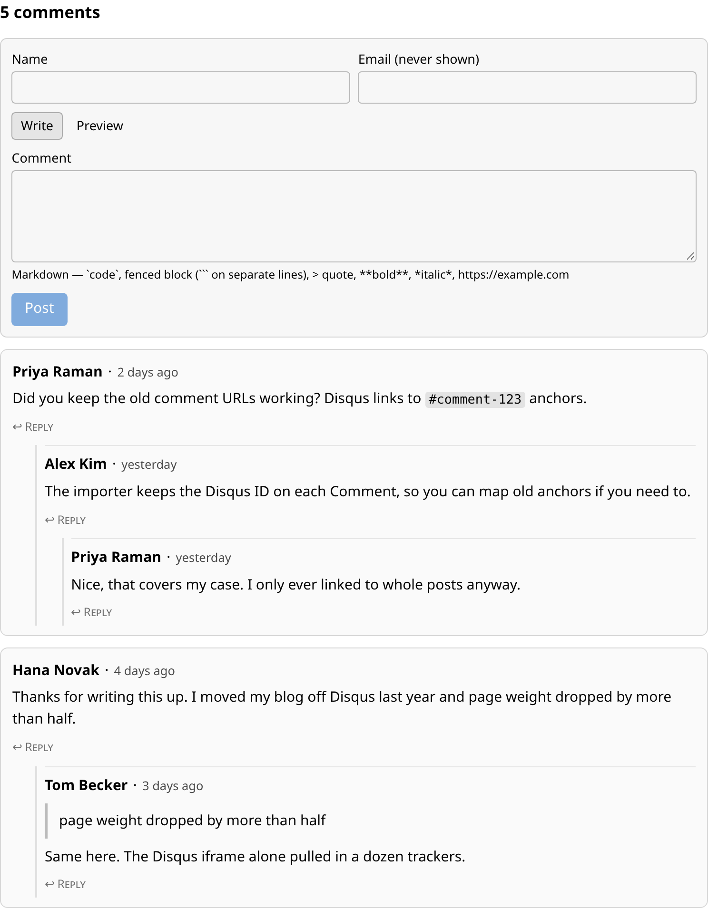
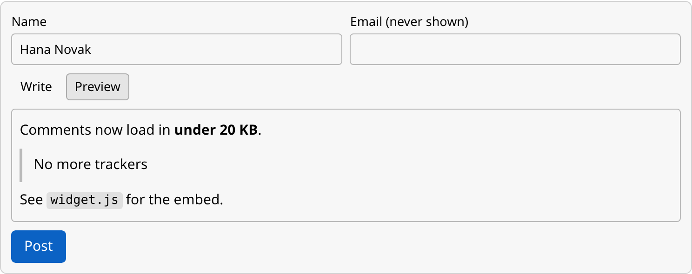
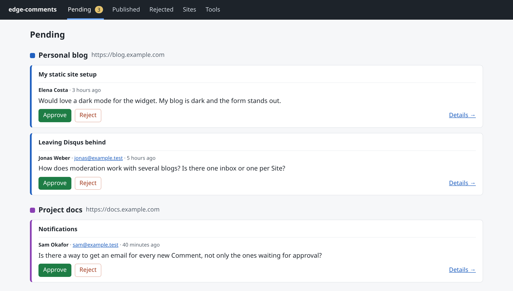

# edge-comments

A small, self-hosted comment system for static websites, running on Cloudflare Workers.

I built it to replace Disqus on [my blog](https://blog.martinhujer.cz). Disqus had become heavy and full of tracking, and I wanted something light that runs entirely on Cloudflare, so there's no server or database for me to look after. One deployment can serve comments for several sites, all moderated in one place.



## What you get

- A comment widget under 20 KB gzipped (JS and CSS together), with no ads or tracking
- Threaded replies and Markdown with a live preview
- Spam protection with Cloudflare Turnstile
- English and Czech translations
- An Admin area behind Cloudflare Access for moderating Comments and managing Sites
- Email notifications for new Comments
- A JSON export, and weekly backups to R2
- An importer for Disqus XML exports

It runs on D1, R2, Turnstile and Access, and it fits in the Workers Free and Zero Trust Free plans.





## Deploy

Clone the repository and run `./deploy.sh` from its root. It asks for a Cloudflare API token, walks you through the dashboard prerequisites, provisions everything, creates your first Site and deploys. Run it again for every later deploy; it only asks for what's missing.

`./deploy.sh` makes changes to your Cloudflare account. Read it first, or ask your coding agent to explain what `deploy.sh` and `scripts/lib/cloudflare.sh` do.

The [self-hosting guide](docs/self-hosting.md) describes every step, including importing from Disqus.

## Embed

`./deploy.sh` prints the snippet for your Sites. Replace `comments.example.com` with your Worker hostname:

```html
<div id="edge-comments"></div>
<script src="https://comments.example.com/widget.js" async></script>
```

After you add a Site or change its Allowed origins in the Admin, run `./deploy.sh` again so Turnstile accepts the new hostnames.

## Documentation

- [Self-hosting and embedding](docs/self-hosting.md)
- [JSON export format](docs/export-format.md)
- [Local tooling and tests](docs/tooling.md)
- [Changelog](CHANGELOG.md)

## Development

You don't need a Cloudflare account to work on it locally:

```bash
npm ci
npm run dev
```

This starts the Worker on port 8787 and a sample page with seeded Comments at <http://localhost:8788>. Run `npm run check` for the fast checks and `npm run test:e2e` for the browser tests. [docs/tooling.md](docs/tooling.md) describes the tooling and the test layers.

## License

[MIT](LICENSE)
